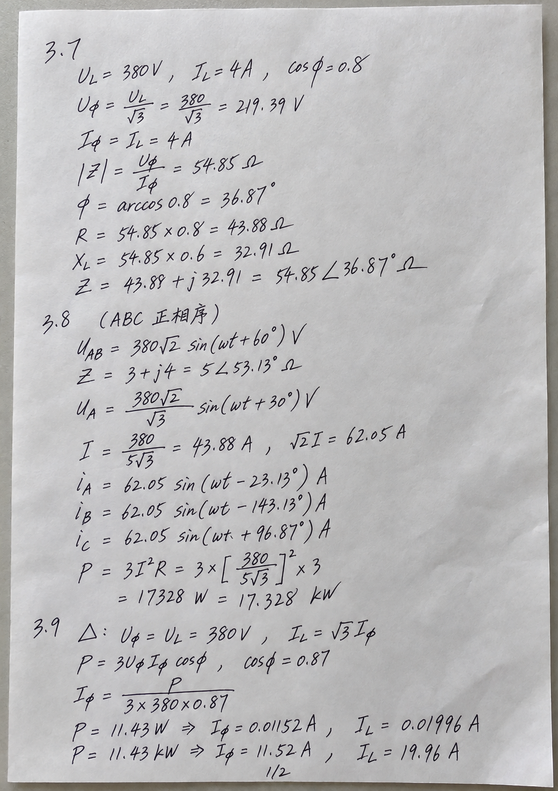

# 免手写作业skill

将题目截图、文字题目或已有答案，整理成以公式、数字和必要配图为主的 A4 手写作业照片。

**题目或答案 → 核算 → 精简表达 → 分页绘图 → 手写照片 → 校对修正**

默认字迹进一步潦草，带快速连笔、大小和轻重变化，偶尔出现少量自然划改或补笔；部分相邻行允许约 **5°** 的倾角差，同时保持题序和最终答案清楚。纸面使用自然光影、轻微褶皱与细纸纹。

## 匿名效果示例



这是生成示例，不是真实个人作业照片；尚未用它验证本次“进一步潦草、偶有涂改”的全部效果。

## 能力

- 从题目解答并核对，或汇总已有答案，理工内容尽量保留公式、代入、结果和单位。
- 根据密度自主分页，不挤小分式、下标和图形标注。
- 支持各类题目配图：函数、数据曲线、几何、受力、运动、光路、结构装置、流程、化学示意、电路、相量、波形等，图种不限于这些例子。
- 实际查看每张成图，检查数字、符号、单位、图形关系与字迹，并局部修正。

## 安装和使用

需要可读取本地 Skill、查看图片并调用内置图像生成与编辑工具的 Codex 环境。安装技能不会解锁工具权限。

```sh
git clone https://github.com/bojinLi/mian-shouxie-zuoye.git ~/.codex/skills/mian-shouxie-zuoye
```

或下载 ZIP，将含 `SKILL.md` 的整个文件夹放入 Codex 的 `skills/` 目录，保留 `agents/`、`references/` 与 `assets/`。

上传题目后可说：

```text
使用 $mian-shouxie-zuoye，把这些题解答后做成 A4 手写作业照片。
按本地参考的字形再潦草一些，偶尔有少量自然涂改，行间约 5° 错位。
保持题序清楚，尽量只留公式数字，画出题目需要的图，页数你决定。
生成后核对答案和图形，不要上传我的真实笔迹照片。
```

## 本地个性化与隐私

私人笔迹照片可保存在本机 `assets/local-only/`，生成时优先用来匹配字形。该目录已被 Git 忽略，**真实作业原图不属于仓库或发布包**。

是否看得到姓名学号都不影响这一原则：校名、校徽、学校抬头和背景信息也不应出现在开源素材中。公开仓库仅包含匿名生成示例和文字规则。没有私人参考时可以使用匿名示例，但不能声称已复刻某个人的笔迹。

## 输出与限制

默认逐页输出 PNG 到当前 `outputs/`，保留生成和修正提示词，同名文件加版本号。公式和各类图形均需实际校对；图像生成可能产生数字、符号或连线错误，不能保证一次正确。约 5° 的错位用于文字行，不破坏图内必须满足的平行、垂直或角度关系。

## 文件

- `SKILL.md`：完整工作流。
- `agents/openai.yaml`：显示名称和默认调用语。
- `references/handwriting-profile.md`：字形、潦草程度、涂改与参考边界。
- `references/prompt-patterns.md`：各类配图、生成与修正提示词。
- `assets/handwriting-reference.png`：匿名生成示例。

## License

技能说明、提示词和匿名生成示例以 [MIT License](LICENSE) 发布。私人本地照片不纳入开源分发。图像服务本身不包含在本仓库中。
